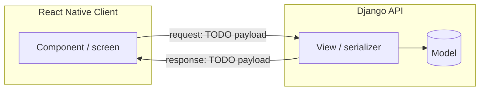
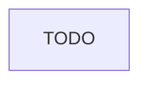

# 3. System Design

<!--
Brief: choose TWO features (from your 10 requirements) with meaningful UI and/or
system-level complexity. For each, provide a system design diagram + a 100–150
word explanation. Marks: 6.
Each diagram must show: client vs API responsibility split; key data exchanged;
major components; relationships between components; external dependencies.
The explanation must: justify the design; explain technical decisions; name one
alternative you considered and rejected.
Diagram type is your choice: component / architecture / sequence / other.
-->

## Selected features

| # | Feature | Source requirement | Diagram type chosen |
|---|---------|--------------------|---------------------|
| 1 | TODO | REQ-TODO | TODO |
| 2 | TODO | REQ-TODO | TODO |

---

## Feature 1 — TODO

### Diagram

<!-- Embed the diagram image, or use a Mermaid block. Keep the source file in docs/diagrams/. -->

### Responsibility split

| Concern | Handled by client | Handled by API |
|---|---|---|
| Validation | TODO | TODO |
| Business logic | TODO | TODO |
| State / caching | TODO | TODO |
| Auth | TODO | TODO |

### Key data exchanged

- Request: TODO
- Response: TODO

### External dependencies

- TODO (library / third-party API / none)

### Explanation (100–150 words)

<!-- Justify the design. Explain the technical decisions. Name and reject one alternative. -->

TODO

Word count: TODO / 150

---

## Feature 2 — TODO

### Diagram

### Responsibility split

| Concern | Handled by client | Handled by API |
|---|---|---|
| Validation | TODO | TODO |
| Business logic | TODO | TODO |
| State / caching | TODO | TODO |
| Auth | TODO | TODO |

### Key data exchanged

- Request: TODO
- Response: TODO

### External dependencies

- TODO

### Explanation (100–150 words)

TODO

Word count: TODO / 150

---

## Marker checklist

- [ ] Two features chosen, both with real UI/system complexity
- [ ] Each diagram shows client/API responsibility split
- [ ] Each diagram shows key data exchanged
- [ ] Each diagram shows major components + relationships
- [ ] External dependencies shown (or "none" stated)
- [ ] Each explanation is 100–150 words
- [ ] Each explanation names a rejected alternative with reasoning
