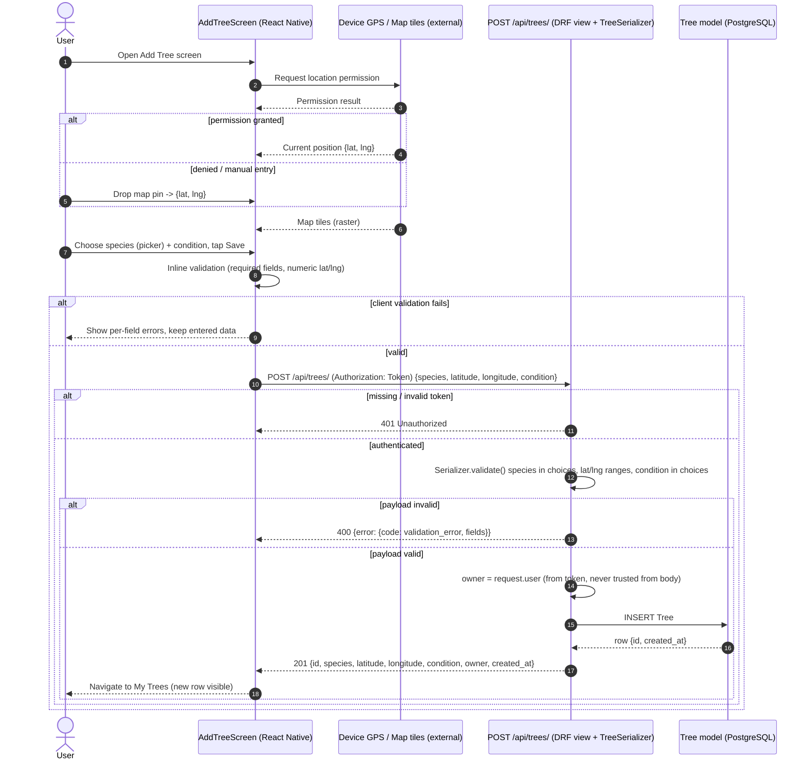
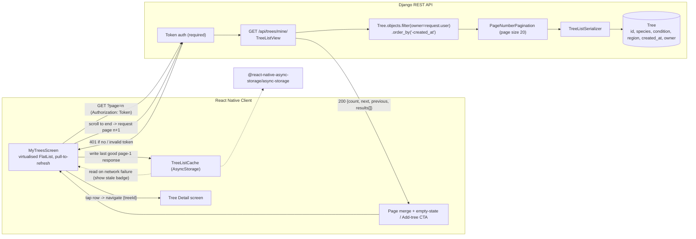

# 3. System Design

<!--
Brief: choose TWO features (from your 10 requirements) with meaningful UI and/or
system-level complexity. For each, provide a system design diagram + a 100–150
word explanation. Marks: 6.
Each diagram must show: client vs API responsibility split; key data exchanged;
major components; relationships between components; external dependencies.
The explanation must: justify the design; explain technical decisions; name one
alternative you considered and rejected.
Diagram type is your choice: component / architecture / sequence / other.
-->

## Selected features

| # | Feature | Source requirement | Diagram type chosen |
|---|---------|--------------------|---------------------|
| 1 | Add a tree with species, location, and condition | REQ-01 — *"As a home gardener, I want to add a tree I've identified with its species, location, and condition, so that I can keep a record of trees I've found."* (Backlog story 1 — Must) | Sequence diagram |
| 2 | Page listing all of my recorded trees | REQ-02 — *"As a user, I want to have a page listing all of my recorded trees, so I can view what trees I have recorded."* (Backlog story 2 — Must) | Component / architecture diagram |

Rationale for the pairing: Feature 1 is the app's UI-heavy write path (location permission, GPS or map-pin capture, inline validation, retry-safe form state) over a stateless authenticated request — a branching, order-dependent flow best read as a **sequence diagram**. Feature 2 is a read path whose difficulty is structural: an owner-scoped queryset, server-side pagination, and an on-device cache with a stale fallback — best read as a **component diagram**. One of each also demonstrates range.

---

## Feature 1 — Add a tree with species, location, and condition

### Diagram

<!-- Sequence diagram. Source kept alongside this file; also renders on GitHub. -->

### Responsibility split

| Concern | Handled by client | Handled by API |
|---|---|---|
| Validation | Inline required-field and numeric/format checks for fast feedback; entered data preserved on any error | Authoritative validation: species/condition against fixed `TextChoices`, latitude/longitude range checks, unknown fields rejected; `400` with per-field errors |
| Business logic | Capture location (GPS fix or manual map pin), assemble the request payload | Set `owner` from the authenticated user, apply create rules, persist the record |
| State / caching | Form state held locally and retained on failure for retry; the created tree is pushed into the My Trees list cache | Stateless — each request authenticated on its own, no server session |
| Auth | Stores the auth token, attaches `Authorization: Token <token>` header | Verifies the token, returns `401` if missing/invalid; the verified identity drives ownership |

### Key data exchanged

- Request: `POST /api/trees/` — header `Authorization: Token <token>`; body `{ species, latitude, longitude, condition }`
- Response: `201 { id, species, latitude, longitude, condition, owner, created_at }`
- Errors: `400 { error: { code, message, fields } }`, `401` (no/invalid token)

### External dependencies

- `expo-location` — runtime location permission + GPS fix (device service)
- `react-native-maps` — raster map tiles from a tile provider for pin placement

### Explanation (100–150 words)

<!-- Justify the design. Explain the technical decisions. Name and reject one alternative. -->

The Add Tree flow is modelled as a sequence diagram because its difficulty is in ordering and branching, not structure. A location permission may be granted or denied, client validation may short-circuit the request, and the server may reject the token or the payload. The client owns capture and fast feedback — GPS or map-pin entry, inline validation, and retaining the form on failure, while the API owns the authoritative rules. It revalidates every field against fixed choices and ranges, and sets `owner` from the token so ownership can never be spoofed from the body. Device location and map tiles are the only external dependencies. An alternative considered was letting the client send `owner` and trusting it for simplicity; this was rejected because it makes the endpoint trivially forgeable and shifts an authorisation decision onto an untrusted client.

---

## Feature 2 — Page listing all of my recorded trees

### Diagram

### Responsibility split

| Concern | Handled by client | Handled by API |
|---|---|---|
| Validation | Coerces the `page` query param to a positive integer before requesting | Rejects an out-of-range or non-integer `page` with `404`; ignores unknown query params |
| Business logic | Merges paginated pages into one continuous list; shows an empty state + "Add tree" CTA when `count` is `0` | Scopes results to `owner = request.user`, orders newest-first, paginates at 20 |
| State / caching | Virtualised list; stores the last successful page-1 response and renders it with a "stale" badge if a refresh fails | Stateless; no per-user list state held server-side |
| Auth | Attaches `Authorization: Token <token>`; routes to login on `401` | Token auth required; the verified token identity *is* the ownership filter — an unscoped list is never exposed |

### Key data exchanged

- Request: `GET /api/trees/mine/?page=<n>` — header `Authorization: Token <token>`
- Response: `200 { count, next, previous, results: [ { id, species, condition, region, thumbnail_url, created_at } ] }`
- Errors: `401` (no/invalid token), `404` (page out of range)

### External dependencies

- Client: `@react-native-async-storage/async-storage` — persists the last-known list for offline / failed-refresh display
- API: none

### Explanation (100–150 words)

My Trees is drawn as a component diagram because its risk is structural, not sequential: the same list data flows through an owner-scoped queryset, a paginator, and a serializer, and is mirrored into an on-device cache. The security-critical decision is that ownership is enforced in the queryset from the verified token, never from a client-supplied `owner` parameter, so one user's request can never return another's trees. The client owns presentation concerns — virtualised scrolling, page merging, the empty state, and showing a stale cached list when a refresh fails — while the API owns scoping, ordering, and pagination. AsyncStorage is the only external dependency; the API needs none. An alternative considered was returning the entire list unpaginated to simplify the client; this was rejected because list size grows unbounded per user and would blow the 1.5 s first-render budget on mobile data.

---
